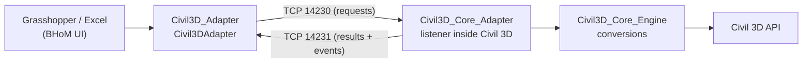

# Civil3D_Toolkit

Tools for Autodesk Civil 3D interoperability with the Buildings and Habitats object Model (BHoM).

The toolkit lets you **pull** drawing objects (points, curves, text, blocks, survey (COGO) points, feature lines, alignments and parcels) from the drawing open in Civil 3D into BHoM, and **push** BHoM geometry, text, block instances and survey points back into it, from Grasshopper, Excel or any other BHoM UI.

## Architecture



- `Civil3DAdapter` runs in the BHoM UI. It sends Push and Pull requests over a socket and waits for the reply.
- The listener is a Civil 3D plug-in. It receives each request on a socket thread, runs it on the AutoCAD main thread with the drawing locked, and sends back the results together with any BHoM errors and warnings.
- `Civil3D_Core_Engine` converts between BHoM and Civil 3D objects. It is the only code, together with the Core adapter, that references Autodesk assemblies.

## Project map

| Project folder | Assembly | Root namespace | Target | References Autodesk? |
|---|---|---|---|---|
| `Civil3D_oM` | `Civil3D_oM` | `BH.oM.Adapters.Civil3D` | netstandard2.0 | No |
| `Civil3D_Engine` | `Civil3D_Engine` | `BH.Engine.Adapters.Civil3D` | netstandard2.0 | No |
| `Civil3D_Adapter` | `Civil3D_Adapter` | `BH.Adapter.Civil3D` | netstandard2.0 | No |
| `Civil3D_Core_Engine` | `Civil3D_Core_Engine_<year>` | `BH.Civil3D.Engine.Core` | net8.0-windows | Yes (`libs/<year>/`) |
| `Civil3D_Core_Adapter` | `Civil3D_Core_Adapter_<year>` | `BH.Civil3D.Adapter.Core` | net8.0-windows | Yes (`libs/<year>/`) |
| `Civil3D_Loader` | `Civil3D_Loader_<year>` | `BH.Civil3D.Loader` | net8.0-windows | Yes (AutoCAD only; no BHoM references) |

## Supported objects

| Object | Pull (Civil 3D → BHoM) | Push (BHoM → Civil 3D) |
|---|---|---|
| `BH.oM.Geometry.Point` | `DBPoint` | `DBPoint` |
| `Line` | `Line` | `Line` |
| `Arc` | `Arc` | `Arc` |
| `Circle` | `Circle` | `Circle` |
| `Ellipse` | Full `Ellipse`; an elliptical arc comes back as a `NurbsCurve` (with a note) | `Ellipse` |
| `Polyline` / `PolyCurve` | `Polyline`, `Polyline2d`, `Polyline3d` → `PolyCurve` of lines and arcs | Lightweight `Polyline` at its elevation if it is flat (all points at one height); otherwise `Polyline3d`, straight segments only |
| `NurbsCurve` | `Spline` | `Spline` |
| `TextNote` | `MText`, `DBText` | `MText` |
| `Block` | `BlockReference` | `BlockReference` (the definition must already exist in the drawing) |
| `BlockDefinition` | `BlockTableRecord` (not layouts, anonymous or xref blocks) | Not yet supported |
| `SurveyPoint` | `CogoPoint` | `CogoPoint` |
| `FeatureLine` | `FeatureLine` | Not yet supported |
| `Alignment` | `Alignment` (spirals approximated as straight lines) | Not yet supported |
| `Parcel` | `Parcel` (found through sites) | Not yet supported |

Every pulled object carries a `DrawingIdentifiers` fragment with the drawing object's handle, layer and class name. On Push, an object's layer is taken from that fragment if the layer exists in the drawing; otherwise the current layer is used. Layers are never created.

Geometry (points and curves) cannot carry fragments, so it is pulled **wrapped in an `ObjectWrapper`**: the geometry is in its `WrappedObject` property and the `DrawingIdentifiers` fragment is on the wrapper. Use the wrapper's `WrappedObject` to work with the geometry itself. Pushing the wrapper back puts the geometry on its original layer; pushing plain geometry puts it on the current layer.

Pull with a `FilterRequest` whose `Type` is one of the types above, or a base type such as `ICurve` to get every curve.

## Building

Prerequisites:
- BHoM 10.0 installed (`C:\ProgramData\BHoM\Assemblies`).
- The .NET 8 SDK or later.

Build everything for Civil 3D 2026:

```bash
dotnet build Civil3D_Toolkit.sln -c Debug2026
```

Close Civil 3D first: it locks the plug-in DLLs. Grasshopper and Excel lock the BHoM-side DLLs in `C:\ProgramData\BHoM\Assemblies`, so close Rhino and Excel too, or the copy after the build fails.

The Autodesk reference assemblies live in `libs/<year>/` (for example `libs/2026/acdbmgd.dll`, `acmgd.dll`, `accoremgd.dll`, `AecBaseMgd.dll`, `AeccDbMgd.dll`). They are used for compiling only and are never copied to the output.

Plain `Debug` and `Release` build the latest supported year.

## Deployment

A build copies the files to where they are loaded from:

| Files | Location |
|---|---|
| `Civil3D_oM.dll`, `Civil3D_Engine.dll`, `Civil3D_Adapter.dll` | `C:\ProgramData\BHoM\Assemblies` |
| `Civil3D_Core_Engine_<year>.dll`, `Civil3D_Core_Adapter_<year>.dll` | `C:\ProgramData\BHoM\Assemblies` |
| `Civil3D_Loader_<year>.dll` | `%AppData%\Autodesk\ApplicationPlugins\BHoM_Civil3D.bundle\Contents\<year>\` |
| `PackageContents.xml` | `%AppData%\Autodesk\ApplicationPlugins\BHoM_Civil3D.bundle\` |

Civil 3D reads `PackageContents.xml` at startup and loads the small `Civil3D_Loader_<year>.dll` from the bundle. The loader has no BHoM references; it loads `Civil3D_Core_Adapter_<year>.dll` from `C:\ProgramData\BHoM\Assemblies` (as `NETLOAD` would), so the adapter finds the BHoM assemblies next to it. The `_<year>` suffix stops BHoM UIs such as Grasshopper from loading the Autodesk-dependent DLLs. The listener then starts on ports 14230 and 14231, and the command line shows `BHoM Civil 3D listener started on ports 14230/14231.`

Use the commands `BHOMDEACTIVATE` and `BHOMACTIVATE` to stop and start (or restart) the listener.

The plug-in also adds the command `BHOMOUT`, which writes every supported object in the active drawing to a JSON file in a `BHoMOut` folder next to the drawing. Geometry is written as `ObjectWrapper`s, as on Pull.

## Debugging

1. Build with `-c Debug2026` and start Civil 3D.
2. In Visual Studio, use **Debug > Attach to Process** and attach to `acad.exe` (managed code).
3. Set breakpoints in `Civil3D_Core_Adapter` or `Civil3D_Core_Engine`, then Push or Pull from Grasshopper.

If the listener does not start (no message on the command line):
- Run `NETLOAD` and load `C:\ProgramData\BHoM\Assemblies\Civil3D_Core_Adapter_2026.dll` by hand. Any load error is shown.
- If the command line says the Core adapter was not found, build the toolkit (or install BHoM) so that `Civil3D_Core_Adapter_2026.dll` is in `C:\ProgramData\BHoM\Assemblies`.
- If the bundle is ignored, check that the `ACADVER` system variable matches `SeriesMin`/`SeriesMax` in `PackageContents.xml` (`R25.1` for 2026).

## Adding a new Civil 3D year

1. Add the year's reference assemblies to `libs/<year>/`.
2. In `Civil3D_Core_Engine.csproj`, `Civil3D_Core_Adapter.csproj` and `Civil3D_Loader.csproj`:
   - add `Debug<year>;Release<year>` to `<Configurations>`;
   - add a `PropertyGroup` for `$(Configuration.Contains('<year>'))` that sets `Civil3DVersion`, `TargetFramework` and `DefineConstants` (`CIVIL3D<year>`).
3. Add the `Debug<year>` and `Release<year>` configurations to `Civil3D_Toolkit.sln`, mapping the BHoM-side projects to plain `Debug`/`Release`.
4. Add the two configurations to `IncludedRepos/altConfigs.txt` in the BHoM_Installer repository (in a separate PR).
5. Add a `<Components>` block for the year to `Civil3D_Loader/Files/PackageContents.xml`, with its `SeriesMin`/`SeriesMax` and `./Contents/<year>/Civil3D_Loader_<year>.dll`.

## Units

BHoM objects are always in SI units (metres). The toolkit detects the drawing's units, from the Civil 3D drawing settings or otherwise from `INSUNITS`, and converts on Pull and Push. If `INSUNITS` is not set, metres are assumed and a warning is shown.

## Parked features

These were removed to get a working, compliant core merged first. Each has an issue with the files and notes needed to restore it:

- [Gravity and pressure pipe networks (#119)](https://github.com/BHoM/Civil3D_Toolkit/issues/119)
- [TIN surfaces, Pull and Push (#120)](https://github.com/BHoM/Civil3D_Toolkit/issues/120)
- [Vertical profiles (#121)](https://github.com/BHoM/Civil3D_Toolkit/issues/121)
- [Infrastructure section definitions (#122)](https://github.com/BHoM/Civil3D_Toolkit/issues/122)
- [Rainbow offset curves (#123)](https://github.com/BHoM/Civil3D_Toolkit/issues/123)
- [Feature line Push (#124)](https://github.com/BHoM/Civil3D_Toolkit/issues/124)
- [Drafting instance: geometry with layer and style (#125)](https://github.com/BHoM/Civil3D_Toolkit/issues/125)
- [Alignment design speeds (#126)](https://github.com/BHoM/Civil3D_Toolkit/issues/126)
- [Block definition Push (#127)](https://github.com/BHoM/Civil3D_Toolkit/issues/127)
- [Collision type and other Block properties (#128)](https://github.com/BHoM/Civil3D_Toolkit/issues/128)
